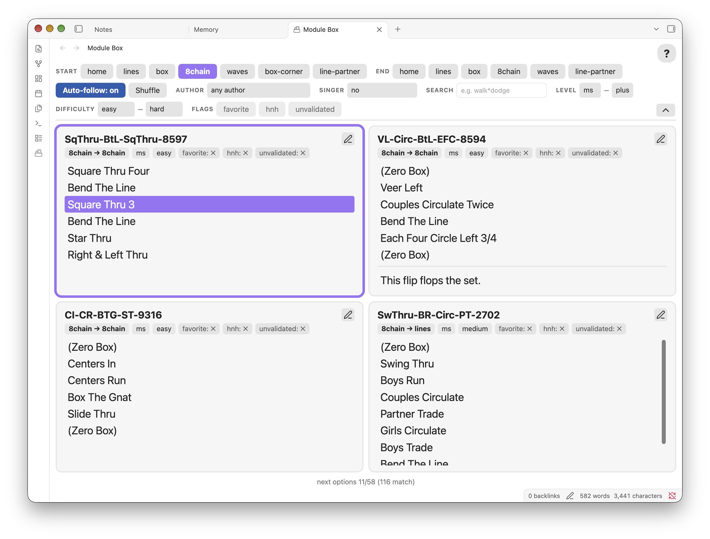

# Square Dance Module Box

**Module Box** is an Obsidian plugin for square dance callers. It replaces the
box of 3×5 cards, one choreography **module** per card, that callers used to
carry around. Your modules are notes in your Obsidian vault. When the dance
floor reaches a formation, Module Box shows the modules that start there on a
large, high-contrast screen you can read from the mic. When a module ends,
it can offer the ones that start where that one finishes.

Module Box works on desktop only. It reads your notes and only writes to
them when you toggle a flag on a card.



## How the screen works

The view is a 2×2 grid of cards.

- **Top row:** the module you're calling now, plus one alternative. The
  selected card is outlined, and the arrow keys move a highlight through its
  calls so you can keep your place.
- **Bottom row:** the next two options, taken from the modules that match the
  filters. Click one, or press `1` or `2`, to call it next. The whole bottom
  row then moves up to the top row.
- **Auto-follow:** when this is on, choosing a module sets the Start filter to
  that module's end formation, so the next options always chain on.
- **Filters:** Start and End formation, Author, Singer, a search of the calls,
  Level and Difficulty ranges, and custom flags. The short filter bar shows Start,
  End and Auto-follow, plus Author, Singer and Search while they're set. The
  chevron under the `?` button shows every filter.

The module order is shuffled each time the view opens and when you click the Shuffle
button. Filters are remembered between sessions.

## Writing modules

A module is a markdown note in the modules folder (`Module-Box` by default;
change it in the plugin settings). Subfolders are included, so you can organize
your modules however you like. Notes whose names start with `_`, such as `_Template.md`,
are skipped. A note must have `start`, `end`, and `level` properties to count as a module.

```markdown
---
start: home
end: home
level: ms
difficulty: medium
author: Frank Lescrinier
favorite: true
---
Heads Square Thru 4,
Right & Left Thru,
Dive Thru,
Centers Square Thru 3,
Allemande Left

---

Anything after a --- line is a comment. It is shown on the card but not
searched, and the highlight skips the --- line.
```

| Property | Meaning |
|---|---|
| `start`, `end` | Formation names, such as `home`, `lines`, `box`, `8chain`, `waves`. Use any names you like; the chips are built from the values in your notes. Chaining needs an exact match: a module ending in `lines` is followed by modules starting in `lines`. |
| `level` | Program level: `ms`, `plus`, `a1`, `a2`, `c1` to `c4`. Any other value is listed as `unk`. |
| `difficulty` | `easy`, `medium`, or `hard`. A missing or other value is listed as `unknown`. |
| `author` | Any text. Filter by it with the Author select. |
| `singer` | Marks modules for singing calls, such as `corner-progression` or `break`. The Singer filter defaults to "no", which shows only modules without this property. |
| Flags | Any property that only ever holds `true` or `false`, such as `favorite`. Each one becomes a filter chip, and a chip on each card that toggles it in the note. A missing flag counts as false. |

Each line of the note body is one call. A trailing comma is removed.

## Keyboard

Press `?` in the view, or click the `?` button, for the full list.

| Keys | Action |
|---|---|
| `↑` `↓` | Move the highlight through the selected card's calls |
| `←` `→` | Page through more next options |
| `1` or `[`, `2` or `]` | Call the left or right next option |
| `h` `l` `p` `b` `c` `8` `w` | Toggle the Start filter: home, lines, line-partner, box, box-corner, 8chain, waves |
| Shift + the same key | Toggle the End filter |
| `a` | Toggle auto-follow |
| `s` | Re-shuffle |
| `f` | Show more or fewer filters |
| `/` | Jump to the search box. Enter or Esc leaves it. |

The formation keys only work for formations that appear in your modules.

## Search

Type words to find modules whose calls contain all of them, in any order.
`*` matches anything within one line, so `walk*dodge` finds both "Walk and
Dodge" and "Walk & Dodge". Case doesn't matter. Only the calls are searched,
not the comments after `---`.

## Installation

Install from **Settings → Community plugins → Browse** and search for
"Square Dance Module Box". Then open the view from the card box icon in the
ribbon, or with the "Square Dance Module Box: Open Module Box" command.

To install by hand, download `main.js`, `manifest.json`, and `styles.css` from
the latest [release](https://github.com/kernwig/module-box/releases) into
`<vault>/.obsidian/plugins/module-box/`, then enable the plugin under
Community plugins.

## Development

Requires Node 24 (see `.nvmrc`).

```sh
npm install
npm run check      # typecheck, tests, and lint; all must pass
npm run build      # writes the plugin files to dist/
```

To try a build in a vault, set `OBSIDIAN_VAULT` to the vault folder. `npm run
build` then also copies `dist/` into
`<vault>/.obsidian/plugins/module-box/`, and `npm run dev` does the same on
every change. Toggle the plugin off and on in Obsidian to load the new build.

```sh
OBSIDIAN_VAULT="$HOME/path/to/vault" npm run dev
```

To release, run `npm version patch` (or `minor`, `major`). It updates
`manifest.json` and `versions.json`, commits, and creates the tag. Then push
the commit and the tag: `git push && git push --tags`. The release workflow
builds the plugin and creates a draft GitHub release. Publish the draft to
make it available in Obsidian.

See [`AGENTS.md`](AGENTS.md) for design notes.

## License

[GPL-3.0](LICENSE)
